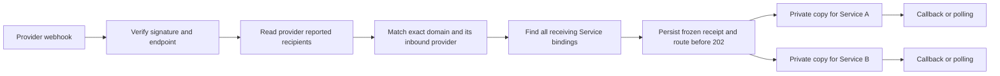
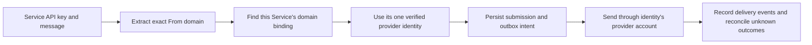

# Application architecture

Envoy is a modular monolith with a Next.js web application and a separate asynchronous worker. PostgreSQL is the authority for business state. The web and worker entry points compose the same framework-independent application services.

The structure follows the Next.js recommendation to use a server-side data access layer with authorization and minimal DTOs, and Spring Boot's business-module organization. Next.js does not prescribe an MVC directory or an ORM. Envoy makes these boundaries explicit so that a use case can be read without reading SQL.

| Responsibility | Location | Rules |
| --- | --- | --- |
| HTTP controllers and server pages | `src/app` | Parse input, identify caller, invoke a public capability, map HTTP results. No SQL. |
| Interactive user interfaces | `src/features/<business>` | Consume explicit DTOs and send resource HTTP requests. No server capability imports. |
| Shared visual components | `src/components` | Reusable presentation and form primitives. |
| Use cases | `src/modules/<module>/application` | Authorization, business decisions, transaction scope and orchestration through ports. No database driver, ORM or infrastructure imports. |
| Pure business rules | `src/modules/<module>/domain` | State transitions, policies and invariants without database/framework dependencies. |
| Persistence | `src/modules/<module>/infrastructure` | Semantic Repository and ReadRepository implementations; SQL, locks, record mapping and constraint handling. |
| Public module boundary | `public.ts`, `contracts.ts` | Server capabilities and browser-safe request/response contracts respectively. |
| Composition | `src/bootstrap`, module `public.ts` | Assemble application ports with concrete adapters. |
| Common infrastructure | `src/platform` | Database, transactions, queue, outbox, crypto, storage, runtime state and identifiers. |
| External mail systems | `src/integrations/providers` | Provider contracts, registry and concrete SDK adapters. |
| Background entry points | `src/worker` | Consume identifiers, invoke shared use cases, schedule recovery. No Next.js or `server-only`, including transitive imports. |

## Business ownership

- `identity`: business services, credentials, domain bindings, capability discovery and service-owned content access.
- `channels`: registered domains, provider accounts and credentials, provider identities and ingress security configuration.
- `outbound`: message acceptance, routing, submissions, attempts, recipient delivery state, retries and reconciliation.
- `inbound`: provider recipient processing, service fanout, retained copies and incremental change discovery.
- `attachments`: private file ownership, scans, byte access and retention.
- `callbacks`: callback endpoints, signing, delivery, replay and dead letters.
- `suppressions`: scoped recipient protection and authorized management.
- `admin`: explicit operator read contracts and cross-domain operational reports. Management writes live in the owning business modules.

Modules import each other's `public.ts` or `contracts.ts`. A `policy.ts` facet may expose pure business policies only when the architecture checker verifies its entire runtime dependency tree has no application orchestration, infrastructure, database, framework, or I/O dependency. An explicit type-only import of a domain type is permitted. Infrastructure may import the four internal identity SQL predicate builders (`domainPermission`, `effectiveDomainBinding`, `outboundDomainAccess`, `inboundDomainAccess`) because they enforce consistent permissions inside locked queries; runtime authorization operations use the public identity service with an opaque transaction context. These are the only cross-module infrastructure exceptions.

## Service identity and routing

Service is the business isolation boundary. Its globally unique name, active/suspended status, domain bindings, callback and suppression management permission are configured independently. API keys belong to one Service and authenticate against its current status. Messages, inbound copies, files and business suppression rules carry only service ownership. Pausing a Service invalidates all its keys and prevents mail content access, inbound delivery and new outbound submission until it is resumed.

Each domain selects one inbound provider account, or none to disable new inbound delivery. A `service_domain_bindings` row connects one Service to one exact domain. Its receive switch grants that Service a private copy and access to its retained mail; multiple Services may receive the same domain. Its optional outbound provider identity selects the single provider account used when that Service sends from the domain. A missing identity disables sending. Suppression scopes are global, Service, or a list within one Service; a Service can manage only its own rules when explicitly authorized.

### Inbound



The mailbox local part does not select a Service. Route ownership is frozen when the verified webhook is accepted, so later provider changes do not discard accepted mail. Resend uses `received_for` from the signed `email.received` event, falling back to its signed `to/cc/bcc` lists when absent. The worker fetches the body and attachments through the Resend API. All Services bound to a recipient domain receive separate copies.

### Outbound



The `From` local part and message category do not change provider selection. A Service can receive on a bound domain without a sending identity, send without receiving, or use both directions.

## Request and query flow

```text
HTTP route / Worker
  -> public application capability
    -> domain rules
    -> semantic Repository ports
      -> Drizzle / parameterized PostgreSQL
```

Routes are resource oriented: services, service credentials, provider accounts, domains, callback endpoints and their explicit subordinate operations. The operator UI sends an HTTP method, resource URL and payload; there is no action-string dispatch endpoint.

Next.js server pages use `src/server/admin-queries.ts`. Each exported operation verifies the current administrator session before executing its reads. This facade is marked `server-only`; domain/application services and worker dependencies are not. ReadRepositories select safe fields and return named DTOs. A generic table renderer or form field dictionary is a UI implementation detail, never the contract for a database row.

## Persistence and transaction boundaries

Drizzle schema definitions live in `src/platform/database/schema`, grouped by business ownership. Ordinary typed CRUD and credential lookup use Drizzle. Complex permission joins, row locks, operational aggregation and PostgreSQL-specific atomic operations remain explicit parameterized SQL inside infrastructure.

Application services define the transaction boundary through `UnitOfWork<Repositories>.run`. The infrastructure factory binds all participating repositories to one connection. Cross-module operations use an opaque `TransactionContext` rather than exposing a `PoolClient` to application code. Repository methods describe an operation such as locking a configuration, saving permissions or recording an attempt; callers do not submit SQL strings.

Accepting a message persists its message, recipient/submission state and Outbox intents atomically. Network requests occur outside the sending state transaction. Workers recover interrupted attempts and treat indeterminate provider acceptance as `unknown`; automatic retries must not risk duplicate delivery. Queue delivery can repeat, so handlers recheck authoritative database state and current permissions.

## Ordered database upgrades

This fresh-project baseline includes the complete application schema and outbound event stream in
`db/migrations/001_initial.sql`. Future structure changes append contiguous SQL versions. The
SHA-256 manifest records each migration. `pnpm db:generate` writes a current `db/schema.sql` from typed definitions,
native invariants and table/column descriptions; it checks exporter completeness and never modifies migration SQL.

Setup runs application upgrades under a transaction-scoped advisory lock. It compares the full catalog with the
recorded schema, verifies recorded checksums, applies missing versions and compares the result with the current
snapshot before committing. A nonempty application schema without a migration journal is rejected. Any failed SQL, schema drift, changed checksum or unexpected recorded version rejects the operation
without changing business data. `envoy_meta.migrations` stores deployment checksums; BullMQ's official schema has
independent bookkeeping. Runtime health and Worker startup check the application version without executing DDL.

Outbound event triggers allocate a per-Service bigint position under a row lock held through commit. A reader's
shared head lock exposes a complete committed prefix, independent of provider occurrence time or transaction start.
The stream contains canonical event/message references, respects current Service-domain bindings and advances past invisible
records. Prefix cleanup atomically advances its retained floor; clients must reconcile message snapshots after gaps.

## Enforcement and verification

`pnpm architecture:check` runs in CI before lint/typecheck/tests/build. It checks:

1. Application/domain and HTTP source contain no SQL or database/infrastructure imports.
2. Cross-module imports respect the public/contracts boundary and the narrow permission-predicate exception.
3. The actual runtime import graph has no cycles; explicit type-only imports do not create runtime dependencies.
4. Worker dependency paths cannot reach Next.js or `server-only`, and client components cannot reach server modules or platform infrastructure.
5. SQL migration versions are contiguous and ordered; schema generation and checksum checks preserve executed SQL.

Type checking verifies DTO and application-port contracts. Unit tests cover pure policies; PostgreSQL integration tests cover constraints, rollback, concurrency, idempotency and permissions. Pipeline/recovery tests cover repeated work, interruption, reconciliation and callback retries. Clean-database tests execute the same ordered migration path used by setup/deployment, including repeated execution, checksum/catalog drift rejection and transactional rollback.

## References

- [Next.js data security and DAL](https://nextjs.org/docs/app/guides/data-security)
- [Next.js backend for frontend](https://nextjs.org/docs/app/guides/backend-for-frontend)
- [Spring Boot code structure](https://docs.spring.io/spring-boot/reference/using/structuring-your-code.html)
- [Spring Modulith module verification](https://docs.spring.io/spring-modulith/reference/verification.html)
- [Drizzle transactions](https://orm.drizzle.team/docs/transactions)
- [node-postgres transactions](https://node-postgres.com/features/transactions)
